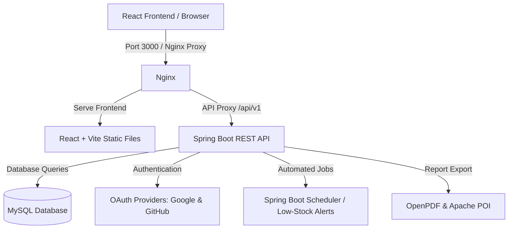
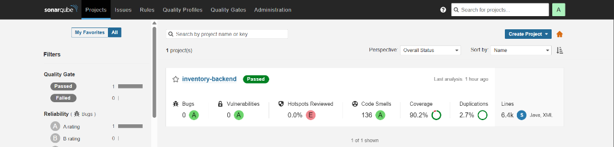

# StockIQ - Full-Stack Inventory & Warehouse Management System

StockIQ is a secure, multi-tenant inventory and warehouse management system. Built with a modern tech stack—**React 19, Spring Boot, MySQL, Flyway migrations, and Docker**—it provides businesses with real-time stock tracking, automated alerts, comprehensive audit logs, visual dashboards, and detailed data exports.

---

## 🏗️ System Architecture



---

## ⚡ Key Features

*   **Multi-tenant Authentication & Authorization:**
    *   Secure standard login/registration with password hashing using **BCrypt**.
    *   **OAuth2 Single Sign-On** integration supporting both **Google** and **GitHub**.
    *   Stateless session management powered by secure **JWT Tokens**.
*   **Intuitive Visual Dashboard:**
    *   Real-time counters for total stock, low-stock items, categories, and suppliers.
    *   Visual representation of inventory distribution by category.
    *   Quick view list of recent transactions.
*   **Full Inventory Control & CRUDs:**
    *   **Products:** Add, edit, remove, and filter products with configurable reorder points.
    *   **Categories:** Categorize items with custom visual icon tags.
    *   **Suppliers:** Record contact information and monitor active/inactive statuses.
*   **Stock Transactions & Tracking:**
    *   Log **Stock-In** (receiving items) and **Stock-Out** (shipping/usage) movements.
    *   Complete stock history log with timestamped transactions.
*   **Automated Notification Engine:**
    *   **Low Stock Alerts:** Automatically scans items whose quantities fall below their reorder points every 30 seconds via Spring Scheduled Cron tasks.
    *   In-app notification tray with status tracking (mark single or all as read, delete alerts).
    *   **Automated Housekeeping:** An automated daily cron job runs at 4:00 AM to clean up notifications older than 30 days.
*   **Robust Audit Trail & Activity Logging:**
    *   Logs key operations (Create, Update, Delete, Stock In, Stock Out) on entities (Product, Category, Supplier, Stock).
    *   Captures original values vs. new values for changes, identifying what was updated, by whom, and when.
*   **Data Export & PDF/Excel Reports:**
    *   Generate on-demand PDF summaries using **OpenPDF (Lowagie)**.
    *   Export rich Excel spreadsheets with custom-styled headers using **Apache POI**.

---

## 🛠️ Technology Stack

### Frontend
*   **Framework:** React 19 (JavaScript ES6)
*   **Build Tool:** Vite (configured with fast HMR & reverse proxying for dev)
*   **Styling:** Tailwind CSS v4 & Bootstrap 5
*   **Routing:** React Router Dom v7 (supporting Guest-only and JWT Protected Routes)
*   **HTTP Client:** Axios (interceptor automatically appends JWT `Bearer` token & tracing headers)

### Backend
*   **Framework:** Spring Boot 4.0.6 (Java 21)
*   **Security:** Spring Security (Stateless filter chain + custom JWT extractor)
*   **Database Access:** Spring Data JPA + Hibernate
*   **Database Migrations:** Flyway Migration Engine
*   **Libraries:** Lombok (for boilerplate reduction), Jackson (JSON parsing)

### Database & Containerization
*   **Production DB:** MySQL 8.4 (relational storage with constraints)
*   **Testing DB:** H2 Database (in-memory test profile)
*   **Containerization:** Docker Engine & Docker Compose (multi-container isolation for MySQL, Nginx, and Backend API)
*   **Reverse Proxy:** Nginx (used inside frontend production container to route static assets and forward API requests to backend)

### Testing & Code Quality
*   **Testing Frameworks:** JUnit 5 & Mockito (unit and slice testing)
*   **Code Coverage:** JaCoCo Maven Plugin (automated HTML test coverage reporting)
*   **Code Quality Gate:** SonarQube Scanner (continuous inspection of code security, reliability, duplications, and code smells)

---

## 📂 Project Structure

```text
├── frontend/
│   ├── public/
│   ├── src/
│   │   ├── components/       # UI Components (Layout, Products, Categories, Stock, Alerts)
│   │   ├── pages/            # Page Views (Landing, Dashboard, AuditTrail, Reports, Auth pages)
│   │   ├── services/         # API Layer (Axios client to interact with backend endpoints)
│   │   ├── routes/           # Routing config (Guest & JWT Protected routes)
│   │   ├── App.jsx           # Main App component
│   │   └── main.jsx          # Entry point
│   ├── package.json          # Frontend dependencies and run scripts
│   ├── vite.config.js        # Vite config with dev API reverse proxy
│   └── Dockerfile            # Frontend Docker containerization
│
├── inventory-backend/
│   ├── src/main/java/com/stockiq/inventory/
│   │   ├── common/           # Enums, custom exceptions, global constants & Activity logger
│   │   ├── config/           # Security configuration, CORS configurations & Jackson settings
│   │   ├── controller/       # Rest controllers mapping API routes
│   │   ├── cron/             # Spring scheduler jobs (low-stock scan & notice cleanup)
│   │   ├── dto/              # Request / Response DTOs
│   │   ├── entity/           # JPA entities representing the relational schema
│   │   ├── repository/       # Repository interfaces
│   │   └── service/          # Business logic layers & implementations
│   ├── src/main/resources/
│   │   ├── db/migration/     # Flyway SQL schema scripts (V1 through V9)
│   │   └── application.yml   # Core configurations & environment bindings
│   ├── pom.xml               # Maven configuration
│   ├── docker-compose.yml    # Full stack Docker-Compose orchestration (MySQL, Backend, Frontend)
│   └── Dockerfile            # Multi-stage Docker builder (Maven compile -> JRE execution)
```

---

## 🗄️ Database Schema Diagram (Flyway Migrations)

The database schema is organized via Flyway migrations located in [db/migration](file:///d:/Inventory%20Management%20System/inventory-management-system/inventory-backend/src/main/resources/db/migration):

*   **`roles`:** Stores role names (`ADMIN`, `USER`).
*   **`users`:** User accounts with name, company name, email, hashed password, and role ID.
*   **`categories`:** Product categories (scoped per-user/tenant via `user_id`).
*   **`suppliers`:** Suppliers details (scoped per-user/tenant via `user_id`).
*   **`products`:** Active warehouse inventory items, including quantities (`qty`), and reorder levels (`reorder_point`).
*   **`stock_transactions`:** Historic record of all product stock movements (`type` is either `IN` or `OUT`).
*   **`notifications`:** Alerts triggered by the cron engine or system events for each tenant.
*   **`audit_trail`:** Action logs tracking entity fields before and after editing, tracking user actions transparently.

---

## 🔌 API Endpoints Reference

All endpoints are prefix-routed under `/api/v1` and require a JWT token in the `Authorization` header (`Bearer <token>`) unless marked public.

| Section | Method | Endpoint | Description | Public / Protected |
| :--- | :--- | :--- | :--- | :--- |
| **Auth** | `POST` | `/auth/register` | Register a new user | Public |
| **Auth** | `POST` | `/auth/login` | Authenticate & retrieve JWT token | Public |
| **Auth** | `POST` | `/auth/forgot-password` | Request password reset | Public |
| **Auth** | `POST` | `/auth/oauth/google` | SSO authentication with Google token | Public |
| **Auth** | `POST` | `/auth/oauth/github` | SSO authentication with GitHub code | Public |
| **Auth** | `GET` | `/auth/me` | Fetch currently logged-in user profile | Protected |
| **Auth** | `PUT` | `/auth/me` | Update logged-in user profile | Protected |
| **Dashboard** | `GET` | `/dashboard/summary` | Retrieve KPI counters & recent logs | Protected |
| **Dashboard** | `GET` | `/dashboard/categories` | Retrieve product count per category | Protected |
| **Products** | `GET` | `/products` | Query products list (supports paging & filters) | Protected |
| **Products** | `POST` | `/products` | Create a new product | Protected |
| **Products** | `PUT` | `/products/{id}` | Update existing product details | Protected |
| **Products** | `DELETE` | `/products/{id}` | Delete a product | Protected |
| **Categories** | `GET` | `/categories` | List all categories for the user | Protected |
| **Categories** | `POST` | `/categories` | Create a category | Protected |
| **Categories** | `PUT` | `/categories/{id}` | Update a category | Protected |
| **Categories** | `DELETE` | `/categories/{id}` | Delete a category | Protected |
| **Suppliers** | `GET` | `/suppliers` | List all suppliers for the user | Protected |
| **Suppliers** | `POST` | `/suppliers` | Create a supplier | Protected |
| **Suppliers** | `PUT` | `/suppliers/{id}` | Update a supplier | Protected |
| **Suppliers** | `DELETE` | `/suppliers/{id}` | Delete a supplier | Protected |
| **Stock** | `POST` | `/stock/move` | Log stock movement transaction (IN/OUT) | Protected |
| **Stock** | `GET` | `/stock/history` | Fetch complete stock transaction history | Protected |
| **Stock** | `GET` | `/stock/alerts` | Fetch current list of low stock items | Protected |
| **Notifications**| `GET` | `/notifications` | List user notifications | Protected |
| **Notifications**| `PUT` | `/notifications/{id}/read`| Mark a specific notification as read | Protected |
| **Notifications**| `PUT` | `/notifications/read-all` | Mark all notifications as read | Protected |
| **Notifications**| `DELETE`| `/notifications/{id}` | Delete a specific notification | Protected |
| **Audit Trail** | `GET` | `/audit-trail` | Fetch audit action history | Protected |
| **Reports** | `GET` | `/reports/inventory` | View current inventory report | Protected |
| **Reports** | `GET` | `/reports/inventory/export` | Export inventory report (format: `pdf` or `excel` blob) | Protected |
| **Reports** | `GET` | `/reports/low-stock` | View current low stock report | Protected |
| **Reports** | `GET` | `/reports/low-stock/export` | Export low stock report (format: `pdf` or `excel` blob) | Protected |
| **Reports** | `GET` | `/reports/supplier` | View current supplier performance report | Protected |
| **Reports** | `GET` | `/reports/supplier/export` | Export supplier report (format: `pdf` or `excel` blob) | Protected |

---

## 🧪 Testing & Code Quality (SonarQube)

StockIQ implements a rigorous testing strategy with a high-coverage backend test suite continuously inspected via **SonarQube** and **JaCoCo**.

### 📊 Code Quality Metrics
The backend project has successfully passed the SonarQube Quality Gate with the following performance scores:



*   **Quality Gate Status:** `Passed` Green ✅
*   **Unit Test Coverage:** `90.2%` (Covering controllers, services, repositories, and scheduling jobs)
*   **Bugs:** `0` (Rating A)
*   **Vulnerabilities:** `0` (Rating A)
*   **Code Smells:** `136` (Rating A)
*   **Duplications:** `2.7%`

### 🔧 Running Tests & Viewing Reports

1.  **Navigate to the backend directory**:
    ```bash
    cd inventory-backend
    ```
2.  **Run the test suite locally**:
    ```bash
    mvn clean test
    ```
3.  **View JaCoCo Coverage Report**:
    Once execution finishes, open the generated HTML report file in any browser to see the line-by-line coverage metrics:
    ```text
    inventory-backend/target/site/jacoco/index.html
    ```
4.  **Perform SonarQube Scan locally**:
    ```bash
    mvn sonar:sonar -Dsonar.projectKey=inventory-backend -Dsonar.host.url=http://localhost:9000
    ```

---

## ⚙️ CI/CD Pipeline (GitHub Actions)

StockIQ has a built-in Continuous Integration (CI) pipeline configured with **GitHub Actions** to automate code validation and Docker packaging on push/pull requests to the `main` and `development` branches.

The pipeline is defined in [.github/workflows/ci.yml](file:///.github/workflows/ci.yml) and performs the following verification jobs:

### 1. Backend Build & Validation
*   **Checkout & Setup:** Retrieves source code and configures **Java 21 (Temurin)** with dependency caching.
*   **Verify Code:** Runs `mvn clean verify` to build classes, execute unit tests, and verify overall package integrity.
*   **Package Verification:** Verifies the multi-stage **Docker build** by running `docker build` on the backend package to guarantee container compatibility.

### 2. Frontend Build & Validation
*   **Checkout & Setup:** Retrieves source code and configures **Node.js 22** with `npm` package caching.
*   **Dependency Resolution:** Performs a clean build dependency install with `npm ci`.
*   **Production Build:** Compiles the static assets and builds the React app bundle (`npm run build`).
*   **Package Verification:** Builds the production **Nginx Docker image** to ensure the client-side container functions correctly.

---

## 🚀 Getting Started

### Prerequisites
Make sure you have the following installed on your machine:
*   [Docker & Docker Compose](https://www.docker.com/) (Recommended)
*   **Or** locally:
    *   Java 21 (JDK) & Maven 3.8+
    *   NodeJS 20+
    *   MySQL Database (Running on port 3306 or 3307)

---

### Option A: Running with Docker Compose (Fastest & Easiest)

We provide a complete Docker Compose file that spins up MySQL, compiles and runs the Java Spring Boot API, compiles the Vite project, and serves the frontend behind an Nginx proxy.

1.  **Navigate to the backend directory containing `docker-compose.yml`**:
    ```bash
    cd inventory-backend
    ```
2.  **Spin up the container cluster**:
    ```bash
    docker-compose up --build
    ```
3.  **Access the Application**:
    *   **Frontend Web App:** Open `http://localhost:3000` in your browser.
    *   **Backend API Base:** Accessible on `http://localhost:8080/api/v1`.
    *   **MySQL Database:** Exposed locally on port `3307` for direct database clients (credentials: User `root`, Password `SHeshan@1234`).

---

### Option B: Running Locally (Development Mode)

If you are developing locally without Docker:

#### 1. Setup MySQL Database
*   Create a local MySQL database schema named `inventory_db`.
*   Ensure MySQL is accessible on `localhost:3306` with your credentials.

#### 4. Run the Spring Boot Backend
1.  Navigate to `inventory-backend` folder:
    ```bash
    cd inventory-backend
    ```
2.  Configure your environment parameters or update [application.yml](file:///d:/Inventory%20Management%20System/inventory-management-system/inventory-backend/src/main/resources/application.yml):
    ```yaml
    spring:
      datasource:
        url: jdbc:mysql://localhost:3306/inventory_db
        username: <your_username>
        password: <your_password>
      flyway:
        enabled: true  # Ensure Flyway auto-applies migrations
    ```
3.  Compile and start the API server:
    ```bash
    mvn spring-boot:run
    ```
    The server will startup on `http://localhost:8080/api/v1`.

#### 3. Run the React Frontend
1.  Navigate to the `frontend` folder:
    ```bash
    cd frontend
    ```
2.  Install dependencies:
    ```bash
    npm install
    ```
3.  Configure environment variables in `.env` file (such as Google/GitHub Client IDs if testing SSO).
4.  Run the Vite development server:
    ```bash
    npm run dev
    ```
    Open `http://localhost:5173` in your browser. The Vite server is configured to proxy all `/api` traffic automatically to the backend on `http://localhost:8080`.

## DevOps Lab Implementation

This project is used to demonstrate an end-to-end DevOps
pipeline using GitHub Actions for automated build and
test validation, with Docker image build verification.